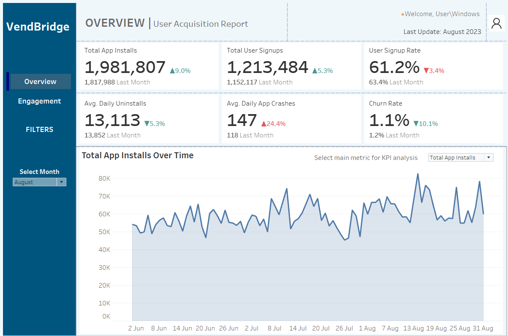
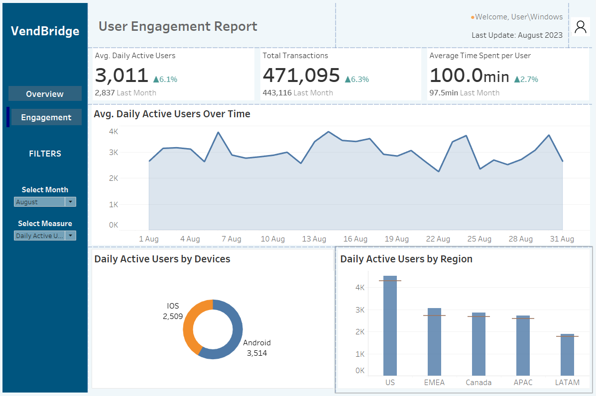

# VendBridge App Acquisition and Engagement Analysis

## Project Overview

This project uses Tableau to explore mobile app acquisition, user engagement and performance. The dashboards compare monthly KPIs and show how activity varies across devices and regions.

The analysis highlights areas for further investigation, including sign-up conversion and app stability.

## Business Questions

- Are app installs translating into user sign-ups?
- How are active users, transactions and time spent changing?
- How does engagement vary by device and region?
- Which performance trends warrant further investigation?

## Tools and Methods

- **Google Sheets:** source data preparation.
- **Tableau:** calculated fields, parameters, monthly comparisons and interactive dashboards.

Created current-month and previous-month calculations to track changes in acquisition and engagement. Added parameters for selecting reporting months and switching displayed measures.

## Dashboard Previews

### User Acquisition Overview

Tracks installs, sign-ups, sign-up conversion, uninstalls and app crashes.

### User Engagement

Tracks daily active users, transactions and average time spent per user, with device and regional comparisons.

## Selected Results

The August 2023 dashboard displays:

| Metric | Value | Monthly comparison |
|---|---:|---|
| App installs | 1,981,807 | Up 9.0% |
| User sign-ups | 1,213,484 | Up 5.3% |
| Sign-up conversion | 61.2% | Previously 63.4% |
| Average daily active users | 3,011 | Up 6.1% |
| Transactions | 471,095 | Up 6.3% |
| Average daily app crashes | 147 | Up 24.4% |

Installs grew faster than sign-ups, while the sign-up conversion rate fell by 2.2 percentage points. This suggests a need to investigate the onboarding journey.

Engagement indicators improved, but the increase in app crashes warrants investigation into affected devices, app versions and user journeys.

## Recommendations

- Examine registration drop-off to identify possible onboarding barriers.
- Investigate recurring crashes and prioritise fixes by user impact.
- Compare regional and device trends to guide further analysis.
- Test engagement initiatives and measure their effect against agreed KPIs.

## Interpretation Notes

- Sign-up conversion is calculated as sign-ups divided by installs during the reporting period. It is an aggregate ratio rather than a tracked user-cohort conversion rate.
- Monthly changes describe patterns in the supplied data and do not establish their causes.
- The dashboard's churn indicator uses uninstalls divided by sign-ups. It is a project-specific measure rather than a customer-level churn rate.
- Screenshots show a historical reporting snapshot.
- Recommendations are proposed actions, not measured business outcomes.

## Public Portfolio Contents

This repository contains the project summary and aggregate dashboard screenshots. Tableau workbooks and underlying data are not included.

## Author

Ayodeji Sonde
